


  

  &nbsp;
  

  
  
  
  

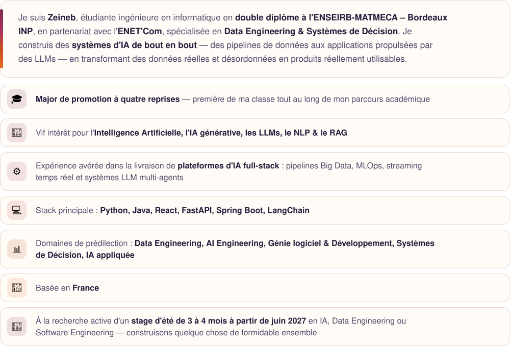

 

<a href="https://github.com/ZeinebGhrab/HM-Retail-Intelligence-platform">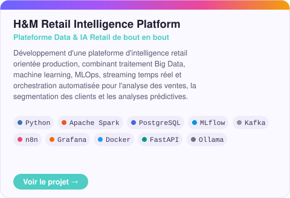</a> <a href="https://github.com/ZeinebGhrab/SparkHire-AI">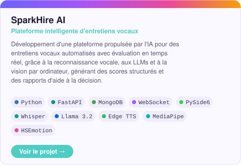</a>
<a href="https://github.com/ZeinebGhrab/EduPlanner"></a> <a href="https://github.com/ZeinebGhrab/AlloCovoit"></a>
<a href="https://github.com/ZeinebGhrab/Aurora"></a> <a href="https://github.com/ZeinebGhrab/Stroke-Clinical-Data-Statistical-Analysis"></a>
<a href="https://github.com/ZeinebGhrab/IDSD-website">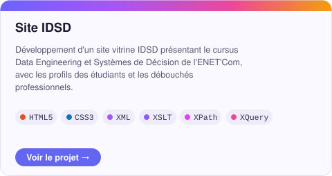</a> <a href="https://github.com/ZeinebGhrab/MiniGit"></a>
<a href="https://github.com/ZeinebGhrab/BookMatch-AI"></a> <a href="https://github.com/ZeinebGhrab/CleanSim-App"></a>
<a href="https://github.com/ZeinebGhrab/princo"></a> <a href="https://github.com/ZeinebGhrab/InvenPro">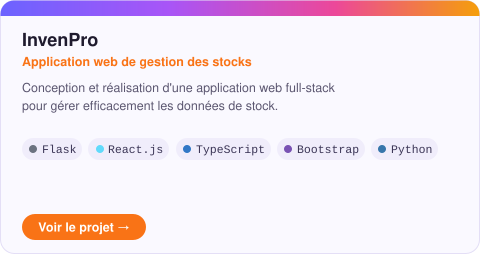</a>
<a href="https://github.com/ZeinebGhrab/Invoice_Generator">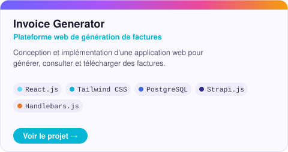</a> <a href="https://github.com/ZeinebGhrab/Discover_world"></a>

 

 
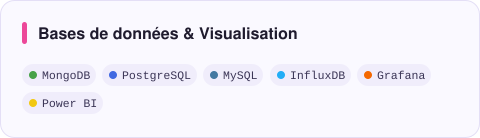 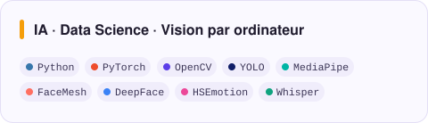
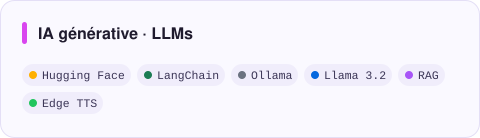 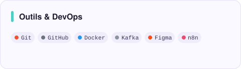

 

 

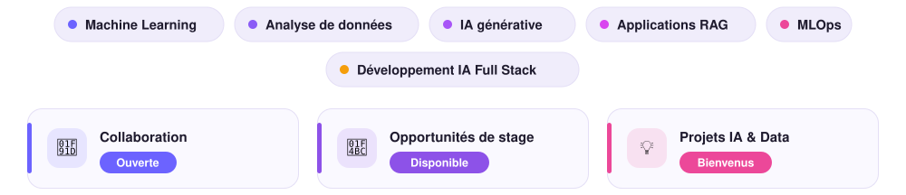

 

